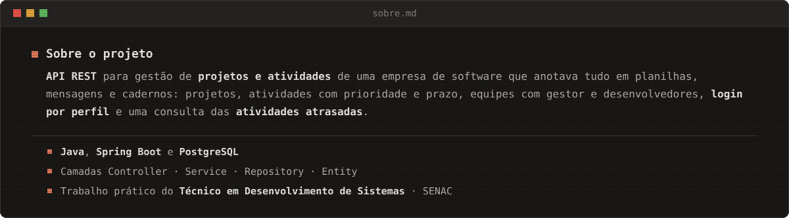
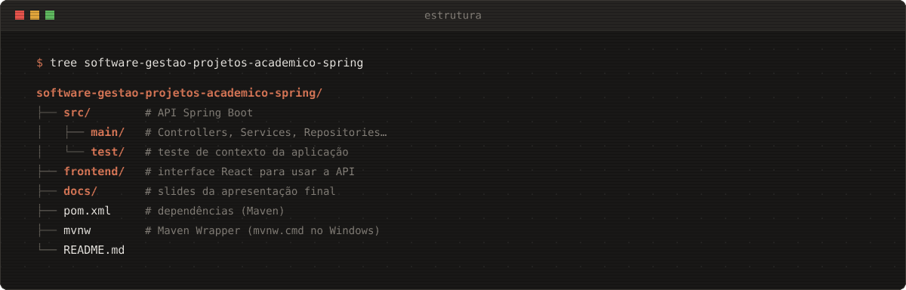

Pré-requisitos: Java 17+, PostgreSQL com o banco `trabalhoAlisson` (a conexão vem das variáveis `DB_*` abaixo) e, para o front-end, Node.js 18+.

1. **Back-end** (na raiz, onde está o `pom.xml`). Sobe em `http://localhost:8080`:

   ```powershell
   # Obrigatório: senha do usuário do PostgreSQL (não fica no repositório)
   $env:DB_SENHA = "sua-senha-do-postgres"
   # Opcional: senha dada aos usuários que ainda não têm senha (veja "Login e perfis")
   $env:SENHA_INICIAL = "12345678"
   .\mvnw.cmd spring-boot:run        # Linux/macOS: ./mvnw spring-boot:run
   ```

   Na primeira execução, com o banco vazio, o `DadosIniciais` cria dados de exemplo (inclusive uma atividade já atrasada) para testar. O **Swagger** fica em `http://localhost:8080/swagger-ui.html`.

2. **Front-end** (na pasta `frontend`). Abra `http://localhost:5173`:

   ```powershell
   copy .env.example .env     # opcional: sem ele, o front usa http://localhost:8080
   npm install
   npm run dev
   ```

   Outros scripts: `npm run typecheck` (verificação de tipos) e `npm run build` (tipos + build de produção em `dist/`).

### Variáveis de ambiente

| Variável | Onde | Para que serve |
| --- | --- | --- |
| `DB_SENHA` | back-end | **Obrigatória.** Senha do usuário do PostgreSQL. |
| `DB_URL` | back-end | Endereço do banco (padrão `jdbc:postgresql://localhost:5432/trabalhoAlisson`). |
| `DB_USUARIO` | back-end | Usuário do banco (padrão `postgres`). |
| `SENHA_INICIAL` | back-end | Senha dada aos usuários que ainda não têm senha. Padrão do `application.properties`: `12345678`; se ficar vazia, é gerada uma aleatória e mostrada **uma única vez** no console. |
| `CORS_ORIGENS` | back-end | Origens liberadas para o front-end (padrão `http://localhost:5173`; várias separadas por vírgula). |
| `VITE_API_URL` | `frontend/.env` | Endereço do back-end. Use `localhost`, e não `127.0.0.1`, para os cookies funcionarem. |

> Se o VS Code der `UserDetailsService.class ... does not exist` ao rodar, rode **Java: Clean Java Language Server Workspace** na paleta de comandos, ou suba pelo terminal com `.\mvnw.cmd spring-boot:run`.



O usuário é o **e-mail** de um gestor ou desenvolvedor, com a senha dele (guardada com BCrypt e nunca devolvida no JSON). O login é por sessão: `POST /auth/login` (campos `email` e `senha`), `GET /auth/me` para saber quem entrou e `POST /auth/logout` para sair. Novos gestores e desenvolvedores recebem a senha no próprio cadastro (`POST /gestor/salvar` e `POST /dev/salvar`).

| Perfil | Pode fazer |
| --- | --- |
| `GESTOR` | Tudo: consultas, cadastros, atualizações, atribuições e ativar/inativar. |
| `DESENVOLVEDOR` | Todas as consultas (`GET`), `PUT /atividade/atualizarStatus/{id}` e `PUT /atividade/atribuirDesenvolvedor`. |

As regras ficam no [`SecurityConfig`](src/main/java/com/trabalho0110/software/Config/SecurityConfig.java). Sem login a API responde `401`; sem permissão, `403`. O CSRF continua ativo (cookie `XSRF-TOKEN`, devolvido no cabeçalho `X-XSRF-TOKEN`), inclusive no Swagger, onde o login fica no grupo **auth-controller**.



O código segue as camadas vistas em aula: o **Controller** só recebe o pedido, o **Service** guarda as regras, o **Repository** conversa com o PostgreSQL e as **Entities** representam as tabelas. Nada de regra escondida nos endpoints.

- Nenhum campo importante pode ficar em branco.
- As datas precisam fazer sentido: nada de prazo no passado, e a atividade tem que caber no período do projeto.
- Um projeto só é concluído quando tem atividades e todas estão concluídas.
- Nada é apagado de verdade: `PUT .../setStatus/{id}` alterna projeto e atividade entre ativo e inativo a cada chamada, e não deixa desativar o que está em andamento.
- Um gestor cuida de uma equipe só, e o desenvolvedor só assume o que for da equipe dele.

### Consulta especial

`GET /atividade/atrasadas` mostra o que já passou do prazo e ainda não foi concluído, com a prioridade mais alta primeiro. É a primeira coisa que um gestor quer ver na segunda-feira.



| Documento | O que tem |
| --- | --- |
| [README do front-end](frontend/README.md) | Passo a passo, login, mapa completo dos endpoints, contrato da API e ajustes feitos no back-end |
| [Apresentação final](docs/Apresentacao_Final.pptx) | Slides do trabalho |
| Swagger (`/swagger-ui.html`) | Endpoints documentados, com a aplicação rodando |

<a href="https://github.com/GabrielCardossso"></a>
